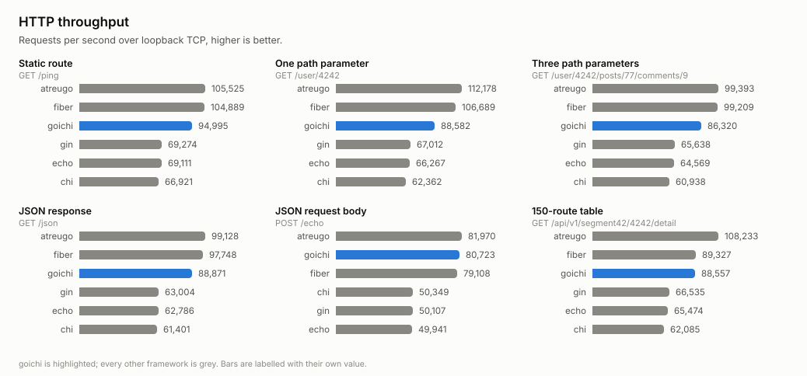
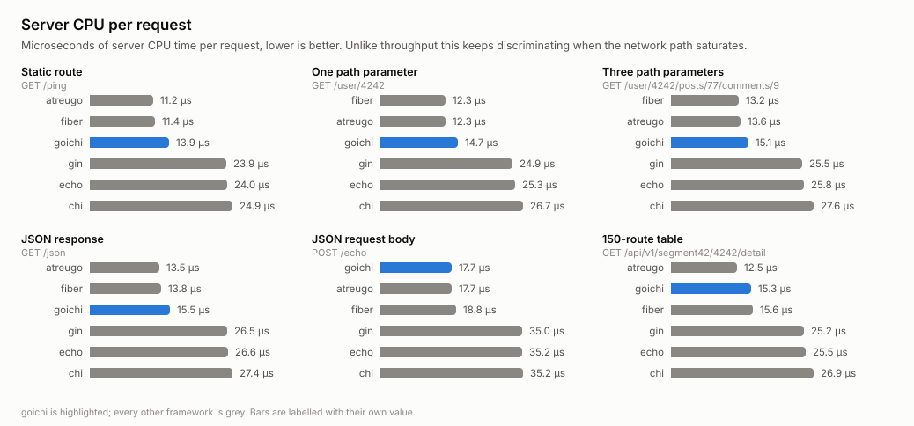

# goichi-bench

REST benchmark for [goichi](https://github.com/goichi-dev/goichi), measured
against **gin**, **fiber**, **chi**, **echo** and **atreugo** on identical
routes — and the regression gate that says whether a change to goichi cost
anything.

This repository exists because a framework that calls itself high-performance
owes the reader numbers, and because the numbers have to be reproducible by
somebody who does not trust the author.

> Only the REST/HTTP surface is measured. goichi's WebSocket, GraphQL, gRPC and
> MQTT protocols are out of scope here.

## What is measured

Six scenarios, issued identically to every framework:

| scenario | request | what it exercises |
|---|---|---|
| `static` | `GET /ping` | dispatch with no parameters, plain-text body |
| `param` | `GET /user/:id` | one captured parameter, JSON body |
| `params3` | `GET /user/:id/posts/:pid/comments/:cid` | deep tree walk, three captures |
| `json` | `GET /json` | serialising a fixed six-field struct |
| `post` | `POST /echo` | binding a JSON request body, then writing it back |
| `many` | `GET /api/v1/segment42/:id/detail` | matching inside a 150-route table |

Two phases produce two kinds of number:

- **HTTP phase** — a real server on loopback TCP, driven by a fasthttp load
  generator: throughput, latency percentiles, and **server CPU time per
  request**.
- **In-process phase** — the framework's own handler called directly, with no
  sockets: **nanoseconds and heap allocations per request**.

## Results

Measured 2026-11-26 on a Linux server, Rocky Linux 10.2: a dual Xeon Gold 6138
(2 × 20 cores, 80 threads) with the governor at `performance`. The run was pinned
with `taskset` to four physical cores on one NUMA node, two for the server and
two for the load generator. Go 1.26.4. goichi v0.6.0, fiber v3.4.0, gin v1.12.0,
echo v4.15.4, chi v5.3.1, atreugo v11.13.2. Raw run:
[`results/r640-v0.6.0.json`](results/r640-v0.6.0.json).



Requests per second, median of three measured windows, every framework passing
the correctness gate with zero errors:

| scenario | atreugo | fiber | goichi | gin | echo | chi |
|---|---|---|---|---|---|---|
| `static` | 105,639 | 106,278 | **98,517** | 69,411 | 69,505 | 67,418 |
| `param` | 110,774 | 110,816 | **94,144** | 67,248 | 66,253 | 63,091 |
| `params3` | 100,176 | 102,678 | **92,890** | 65,906 | 64,905 | 61,185 |
| `json` | 100,742 | 98,802 | **90,917** | 63,152 | 63,186 | 61,574 |
| `post` | 83,881 | 81,219 | **82,632** | 50,247 | 50,066 | 49,791 |
| `many` | 108,183 | 91,290 | **89,962** | 66,833 | 65,924 | 62,508 |

The frameworks separate into two groups, and the split is the HTTP stack rather
than the router: atreugo, fiber and goichi sit on fasthttp, gin, echo and chi
sit on `net/http`. goichi is the slowest of the fasthttp group, up to 15.0%
below fiber, and 35–66% above the `net/http` routers on every scenario — a lead
that belongs mostly to fasthttp, not to goichi's router. On `post` (+1.7%) and
`many` (−1.5%) goichi and fiber are within the run-to-run drift measured below,
so those are ties; on `static` (−7.3%) and `param` (−15.0%) the gap is real.



Throughput on loopback is bounded by the socket as much as by the framework, so
the server's own CPU time per request is the figure that keeps separating them
after the network path stops:

| µs of server CPU per request | `static` | `params3` | `post` |
|---|---|---|---|
| atreugo | 11.2 | 13.6 | 17.7 |
| fiber | 11.4 | 13.2 | 18.8 |
| **goichi** | **13.9** | **15.1** | **17.7** |
| gin | 23.9 | 25.5 | 35.0 |
| echo | 24.0 | 25.8 | 35.2 |
| chi | 24.9 | 27.6 | 35.2 |

### What v0.6.0 changed

v0.6.0 reuses each request's `Context` and keeps the path parameters in a
buffer inside it, instead of allocating a `Context` and a parameter map per
request. To keep the comparison inside one window, v0.5.1 and v0.6.0 were
measured alternately, twice each, against fiber, gin and chi as the control:
[`results/ab-v0.5.1-v0.6.0/`](results/ab-v0.5.1-v0.6.0/). The figures are the
mean of the two runs of each. The v0.6.0 runs were built, before the tag existed,
from goichi commit `3710af5` through a `replace` directive, whose code is
identical to the v0.6.0 tag; their result files therefore record the goichi
version as `v0.5.1`, the one named in `go.mod` at the time.

| scenario | v0.5.1 | v0.6.0 | | µs server CPU/req | allocs/op | B/op |
|---|---|---|---|---|---|---|
| `params3` | 87,595 | 92,083 | **+5.1%** | 16.3 → 15.2 | 5 → 2 | 448 → 80 |
| `param` | 90,709 | 94,020 | **+3.6%** | 15.6 → 14.7 | 5 → 2 | 400 → 32 |
| `many` | 89,742 | 92,676 | **+3.3%** | 15.8 → 15.0 | 5 → 2 | 416 → 48 |
| `json` | 88,431 | 89,322 | +1.0% | 15.8 → 15.7 | 3 → 2 | 117 → 97 |
| `post` | 82,087 | 82,641 | +0.7% | 17.8 → 17.7 | 6 → 5 | 173 → 141 |
| `static` | 98,116 | 97,541 | −0.6% | 13.9 → 14.0 | 2 → 1 | 37 → 5 |

The control frameworks moved by a median of 0.3% and at most 2.5%, so the three
routes that capture parameters gain for real, and so does their CPU time (5–7%
less per request). The other three lose one allocation each and are otherwise
unchanged. On `param` goichi now allocates exactly what fiber does: 2
allocations, 32 B.

```bash
go run ./cmd/compare -base results/ab-v0.5.1-v0.6.0/v0.5.1-1.json -new results/ab-v0.5.1-v0.6.0/v0.6.0-1.json
```

### What v0.5.1 changed

goichi installs a set of security headers on every response by default, and
v0.5.0 set them in a way that normalised each header name again on every
request. v0.5.1 prepares them once. A v0.5.0 run was made right before the
v0.5.1 one, on the same host:
[`results/r640-v0.5.0-rerun.json`](results/r640-v0.5.0-rerun.json).

| scenario | v0.5.0 | v0.5.1 | | µs server CPU/req | in-process ns/op |
|---|---|---|---|---|---|
| `many` | 84,892 | 90,817 | **+7.0%** | 16.8 → 15.7 | 2,469 → 1,899 |
| `static` | 93,491 | 99,175 | **+6.1%** | 14.7 → 13.9 | 1,490 → 969 |
| `json` | 86,291 | 91,404 | **+5.9%** | 16.3 → 15.6 | 2,461 → 1,841 |
| `params3` | 86,003 | 88,663 | +3.1% | 16.8 → 16.2 | 2,715 → 2,165 |
| `post` | 80,959 | 82,978 | +2.5% | 18.3 → 17.6 | 3,726 → 3,137 |
| `param` | 88,555 | 88,729 | +0.2% | 16.2 → 15.7 | 2,255 → 1,710 |

Every scenario saves 520–620 ns in process and 3–7% of server CPU per request,
with allocations unchanged. The five other frameworks moved by a median of 0.8%
and at most 2.4% between the two runs, so the throughput gains above 2.4% are
real; `param` gained in CPU time but not in throughput.

```bash
go run ./cmd/compare -base results/r640-v0.5.0-rerun.json -new results/r640-v0.5.1.json
```

### What v0.5.0 changed

A v0.2.0 run was made on the same host the same afternoon, right before the
v0.5.0 one: [`results/r640-v0.2.0.json`](results/r640-v0.2.0.json).

| scenario | v0.2.0 | v0.5.0 | | µs server CPU/req | allocs/op |
|---|---|---|---|---|---|
| `json` | 80,546 | 88,871 | **+10.3%** | 17.6 → 16.2 | 3 → 3 |
| `many` | 82,165 | 88,558 | **+7.8%** | 17.5 → 16.3 | 5 → 5 |
| `param` | 82,373 | 88,583 | **+7.5%** | 17.3 → 16.1 | 5 → 5 |
| `static` | 89,445 | 94,996 | **+6.2%** | 15.5 → 14.4 | 2 → 2 |
| `post` | 76,206 | 80,724 | **+5.9%** | 19.6 → 18.3 | 5 → **6** |
| `params3` | 82,174 | 86,320 | **+5.0%** | 17.8 → 16.8 | 5 → 5 |

goichi gained 5.0–10.3% on every scenario and spent 6–8% less server CPU per
request, well clear of the noise measured below, so the gain is real.

```bash
go run ./cmd/compare -base results/r640-v0.2.0.json -new results/r640-v0.5.0.json
```

It cannot be pinned on one change. v0.2.0 to v0.5.0 updates goichi's own
dependencies, among them `fasthttp` v1.73.0 to v1.80.0 and `goccy/go-json`
v0.10.6 to v0.12.0. goichi serves on `fasthttp`, and the update is forced on
fiber and atreugo too, because a module graph carries one version of it; the
load generator uses it as well. Neither of those two frameworks moved, which
suggests `fasthttp` is not where goichi's gain comes from, but this benchmark
does not separate the causes.

`post` now makes one more allocation per request (5 → 6) while allocating 19%
fewer bytes (213 → 173 B). `cmd/compare` reports that as a regression, as it
should: allocation counts are deterministic. It is not visible in throughput or
CPU time, which both improved.

The extra allocation comes from `goccy/go-json` v0.12.0, not from goichi, whose
request path did not change between the two releases. Decoding this body alone
takes 2 allocations and 128 B with v0.10.6 and 3 allocations and 88 B with
v0.12.0 — the whole difference the benchmark sees. Older versions copied the
input once and let every decoded string point into that copy; v0.12.0 reuses
its input buffer and copies each string out on its own, as `encoding/json`
does, so a decoded string no longer keeps the whole body alive. The request
body here has two string fields, hence one allocation more. go-json can skip
the copy with `DecodeNoCopyString`, but goichi decodes straight from fasthttp's
request buffer, which is reused after the request, so a string kept by a
handler would be overwritten. The copy is the correct trade.

### How much of this is noise

The v0.2.0 and v0.5.0 runs measured all six frameworks, so the five whose code
did not change between them are a control group for the host itself:

| `static`, unchanged frameworks | v0.2.0 run | v0.5.0 run | drift |
|---|---|---|---|
| atreugo | 104,774 | 105,525 | +0.7% |
| fiber | 105,613 | 104,890 | −0.7% |
| gin | 69,097 | 69,275 | +0.3% |
| echo | 68,720 | 69,111 | +0.6% |
| chi | 66,210 | 66,921 | +1.1% |

Across all six scenarios those five frameworks drift by at most 4.9% between the
two runs, a median of 0.8%, and the spread inside the v0.5.0 run is
±0.2–5.8% (median ±1.2%). Differences smaller than that are not differences —
which is why the 2.0% between goichi and fiber on `post` is reported as a tie
and the 17.0% on `param` is not.

The host is not otherwise idle: it also runs a Kubernetes test environment. The
runs were started only after it had been at least 97% idle for several minutes,
and it was checked every two minutes for competing load. The pinned cores keep
the benchmark off the rest of the machine, not the rest of the machine off them,
so the drift figures above include that background. It is a reason to reproduce
these numbers rather than trust them.

### In-process figures

The in-process phase measures allocations, and there goichi's `post` path is the
lightest in the comparison — 5 allocations per request against fiber's 9 and
gin's 14. Its nanoseconds-per-operation figures, however, are the slowest here
(959 ns on `static` against fiber's 366 ns), which is not consistent with its
HTTP result and should not be read as a cross-framework ranking: the phase calls
each framework's own handler through each framework's own request object, and
those are not the same object. Its job is to compare a framework against its own
past, which is what the version tables above use it for.

Charts and the HTML report are generated into `docs/` by `cmd/report`, and the
raw measurements land in `results/`, one JSON file per run.

### Earlier results: Xeon E3-1230 v6, 2026-08-13

The first published runs were made on a different machine — Xeon E3-1230 v6 (4
cores, hyper-threading off, governor pinned to `performance`), Ubuntu 24.04,
Go 1.26.4 — so their figures are not comparable with the tables above. On that
host goichi v0.2.0 also came third of six. Raw runs:
[`results/linux-v0.1.0.json`](results/linux-v0.1.0.json) and
[`results/linux-v0.2.0.json`](results/linux-v0.2.0.json).

goichi v0.2.0 stopped copying the parameter map on every candidate branch while
matching. v0.1.0 against v0.2.0 on that host:

| scenario | v0.1.0 | v0.2.0 | | allocs/op |
|---|---|---|---|---|
| `params3` | 84,322 | 101,800 | **+20.7%** | 16 → 5 |
| `many` | 87,485 | 103,938 | **+18.8%** | 22 → 5 |
| `post` | 86,594 | 95,093 | +9.8% | 7 → 5 |
| `json` | 95,669 | 103,947 | +8.7% | 7 → 3 |
| `param` | 97,370 | 103,018 | +5.8% | 8 → 5 |
| `static` | 111,896 | 114,098 | +2.0% | 4 → 2 |

The gain lands where the change predicts it should: the routes that capture the
most parameters gain the most, and `static` — which never touched the parameter
map — barely moves. The five unchanged frameworks drifted by at most 2.9%
between those two runs (median 0.8%).

```bash
go run ./cmd/compare -base results/linux-v0.1.0.json -new results/linux-v0.2.0.json
```

## Running it

```bash
go run ./cmd/goichi-bench -out results/latest.json   # measure (~13 min)
go run ./cmd/report -in results/latest.json -out docs # render charts + report
```

Useful flags:

| flag | default | meaning |
|---|---|---|
| `-frameworks` | all | comma-separated subset, e.g. `goichi,fiber` |
| `-phase` | `all` | `http` or `micro` to run one phase |
| `-connections` | `64` | concurrent connections in the HTTP phase |
| `-duration` | `5s` | measured window per scenario |
| `-repeat` | `3` | measurements per scenario; the median is kept |
| `-benchtime` | `1s` | measured window per in-process benchmark |

The run exits non-zero if any framework fails the correctness gate.

## The regression gate

Record a baseline, change goichi, measure again, and let the exit code decide:

```bash
go run ./cmd/goichi-bench -out results/baseline.json
# ... change goichi ...
go run ./cmd/goichi-bench -out results/latest.json
go run ./cmd/compare -base results/baseline.json -new results/latest.json
```

Allocation and byte counts are deterministic, so they are allowed to move **0%**
— one extra allocation per request is a regression and is reported as one.
Timings are noisy, so they get a tolerance (`-tolerance`, default 15%; tail
latency gets double). `compare` exits non-zero when anything regresses.

## Benchmarking unreleased goichi

`go.mod` pins the published goichi release, so a fresh clone reproduces the
published numbers. To measure a working tree instead:

```bash
go mod edit -replace github.com/goichi-dev/goichi=../goichi
go run ./cmd/goichi-bench -frameworks goichi -out results/goichi-dev.json
go mod edit -dropreplace github.com/goichi-dev/goichi
```

## How the comparison is kept honest

**Every framework returns the same bytes.** Before any timing, each server is
asked every scenario once and its response is compared against a fixed expected
body. A framework that answers something shorter, or with a different status,
fails the gate and the run fails with it — being fast by doing less is not
available.

**Each framework is used the way its own documentation shows.** Its own router
syntax, its own JSON writer, its own request binder, and whatever middleware it
installs by default. Where a framework does more work per request because that
is what it ships, the cost is counted: that is what its users actually pay.

**One framework per process, one at a time.** No two frameworks share a heap, a
garbage collector or a scheduler. The load generator is pinned to half the
machine's cores and the server to the other half, so neither starves the other.

**The median of repeated measurements**, with the spread between fastest and
slowest repeat recorded next to it. A difference smaller than that spread is
not a difference.

**Server CPU time per request is measured, not inferred.** The orchestrator
reads the server process's own CPU counters around the measured window
(`GetProcessTimes` on Windows, `/proc/<pid>/stat` on Linux). This matters
because a loopback interface saturates before a modern Go router does: once
every framework is bounded by the same network path they report almost the same
throughput, while CPU per request keeps separating them.

**Latency is measured with a clock that can see it.** On Windows `time.Now()`
advances in steps of about half a millisecond — longer than the request being
timed — so percentiles taken from it collapse into "0 ms" and "1 ms". The load
generator uses `QueryPerformanceCounter` there instead.

**The system timer period is pinned for the length of the run.** Windows wakes a
waiting thread on a timer whose period defaults to 15.625 ms, and the Go runtime
raises it to 1 ms only while it has timers to service, dropping it again when
the process goes briefly idle — so which period is in force during a measurement
is decided by unrelated activity on the machine. A measurement that straddles a
drop sees requests wait for the next tick: throughput falls by a factor of
three, tail latency lands exactly on 15.6 ms, and CPU time per request does not
move at all, because the work per request never changed and only the waiting
grew. Unpinned, one framework measured anywhere between 40k and 180k req/s
within a single run, a gap far wider than any real difference between the
frameworks. The orchestrator now holds the finest period from start to finish
and records it in the result file, so a run made without it can be recognised
later.

## What these numbers do not say

- **Throughput here is a floor, not a ceiling.** Client and server share one
  machine; on a saturated loopback the frameworks bunch together.
- **The in-process phase compares a framework with its own past first.** Across
  stacks it also compares two different request objects: a fasthttp
  `RequestCtx` is not a `net/http` `Request`, and that difference is inside the
  measurement.
- **atreugo has no in-process figures.** It keeps its `fasthttp.RequestHandler`
  unexported, so it can only be driven through a real listener. It takes part
  in the HTTP phase and is reported as `n/a` in the in-process one.
- **goichi does more per request than the others.** Its defaults install a
  panic recoverer and six security headers (`X-Content-Type-Options`,
  `X-Frame-Options`, `Referrer-Policy`, `X-Xss-Protection`,
  `Content-Security-Policy`, `Strict-Transport-Security`) on every response.
  fiber, gin (`gin.New`), echo, chi and atreugo are measured with no middleware
  at all, as they ship. Its figures include that work, as its users pay for
  it. Turning the headers off to close the gap would measure a configuration
  nobody runs by default.
- **One machine, one operating system.** Numbers measured elsewhere are not
  comparable to these. Re-run the suite on the host you care about.

## Layout

```
cmd/goichi-bench   orchestrator: runs every framework, writes the result JSON
cmd/report         result JSON -> SVG charts + HTML report
cmd/compare        two result JSONs -> regression verdict
cmd/worker         serves, or measures, exactly one framework (spawned)
internal/apps      one REST application per framework, identical routes
internal/loadgen   HTTP load generator and latency histogram
internal/micro     in-process measurement
internal/procstat  another process's CPU time
internal/clock     a monotonic clock fine enough to time one request
internal/chart     SVG charts and the HTML report
```

## License

MIT — see [LICENSE](LICENSE).
